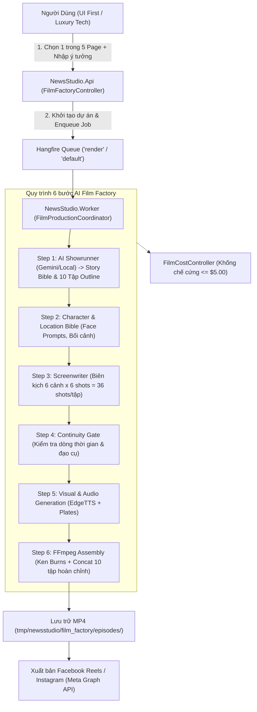

# KIẾN TRÚC TỔNG THỂ HỆ THỐNG AI FILM FACTORY
## Hệ thống AI tự động sản xuất phim người thật – 5 Film Pages – 10 tập × 5 phút

**Tài liệu:** `AI_FILM_FACTORY_ARCHITECTURE.md`  
**Phiên bản:** 2.0 Production  
**Ngày phát hành:** 17/11/2026  
**Chủ trì kiến trúc:** Senior Software Architect, AI Film Director, Video Editing Automation Engineer  

---

## 1. TỔNG QUAN KIẾN TRÚC

Hệ thống **AI Film Factory** là một phân hệ độc lập cao cấp được tích hợp bên trong giải pháp truyền thông tự động hoá, kế thừa toàn bộ nền tảng hạ tầng sẵn có (.NET 8 Clean Architecture, PostgreSQL, Hangfire Distributed Queues, EdgeTTS, FFmpeg Media Engine, Meta Graph API v20.0) nhưng hoàn toàn cô lập về dữ liệu và luồng nghiệp vụ với phân hệ tin tức (Trạm Tin 24/7).

Mục tiêu nghiệp vụ cốt lõi:
- **Quy mô đầu ra:** 10 tập × 5 phút = 50 phút phim người thật AI hoàn chỉnh cho mỗi series.
- **5 Kênh phim chuyên biệt:** Hoạt động độc lập về thể loại, phong cách thẩm mỹ, bảng màu nhận diện và đối tượng khán giả.
- **Trí tuệ điều phối (AI Showrunner):** Tư duy kịch bản 3 hồi, cấu trúc 10 tập mạch lạc, bộ nhớ Series Bible dài hạn không suy giảm chi tiết.
- **Giữ vững tính nhất quán (Character Consistency):** Nhân vật có hồ sơ ID, facial prompt tham chiếu, bối cảnh ánh sáng chuẩn mực.
- **Bảo vệ ngân sách tuyệt đối:** Khống chế chi phí thực tế ở mức **0 – 5 USD / Trọn bộ 10 tập (50 phút)** nhờ chiến lược Hybrid Visual Engine kết hợp EdgeTTS giọng đọc tiếng Việt miễn phí 100%.

---

## 2. NGUYÊN TẮC BẢO VỆ PHÂN HỆ TIN TỨC HIỆN TẠI (ZERO BREAKING CHANGES)

1. **Phân vùng Namespace độc lập:**
   - Domain: `NewsStudio.Domain.Entities.FilmEntities.cs` chứa các thực thể bắt đầu bằng tiền tố `Film*`.
   - Application: `IFilmServices.cs` và `FilmDtos.cs` nằm riêng biệt, không chỉnh sửa các interface `IVideoProductionService`, `IArticleExtractorService`.
   - Infrastructure: Toàn bộ logic nghiệp vụ phim đặt tại thư mục riêng `backend/src/NewsStudio.Infrastructure/FilmFactory/`.
   - Controller: `FilmFactoryController.cs` phụ trách route `/api/film-factory/*`, không chạm vào `/api/videos/*` hay `/api/system/*`.
2. **Bảo toàn Database Schema:**
   - Bổ sung 11 bảng cơ sở dữ liệu mới qua migration `20261117091104_AddAiFilmFactory`.
   - Không thay đổi kiểu dữ liệu, quan hệ hoặc khoá chính/ngoại của bất kỳ bảng tin tức hiện hữu nào (`VideoProjects`, `Articles`, `FacebookPosts`, `SystemSettings`).
3. **Bảo toàn cấu hình AI & API Keys:**
   - Tái sử dụng bảng `SystemSettings` và danh sách Google Gemini API keys sẵn có.
   - Cơ chế đọc khoá ưu tiên khoá miễn phí (Free Tier) trước khi dùng khoá trả phí.

---

## 3. KIẾN TRÚC CHI TIẾT CỦA PHÂN HỆ AI FILM FACTORY

### 3.1. Phân tầng Clean Architecture

| Tầng (Layer) | Project | Trách nhiệm |
| :--- | :--- | :--- |
| **Domain** | `NewsStudio.Domain` | Định nghĩa 11 Entity nghiệp vụ: `FilmPage`, `FilmProject`, `FilmStoryBible`, `FilmCharacter`, `FilmCharacterReference`, `FilmLocation`, `FilmContinuityRecord`, `FilmEpisode`, `FilmScene`, `FilmShot`, `FilmCostRecord`, `FilmPublishingRecord`. |
| **Application** | `NewsStudio.Application` | Hợp đồng giao tiếp (`IFilmFactoryService`, `IFilmShowrunnerService`, `IFilmCostController`, `IFilmRendererService`, `IFilmProductionCoordinator`) và DTOs chuyển giao dữ liệu. |
| **Infrastructure** | `NewsStudio.Infrastructure` | Thực thi nghiệp vụ chi tiết, tích hợp EF Core Npgsql, EdgeTTS, FFmpeg Ken Burns generator, Gemini API client, Hangfire job dispatcher. |
| **Presentation** | `NewsStudio.Api` | Endpoint RESTful `/api/film-factory/*` phục vụ ứng dụng web quản trị. |
| **Background Host** | `NewsStudio.Worker` | Xử lý đa tác tử bất đồng bộ, render video tập phim, giải phóng tài nguyên CPU/RAM. |
| **Frontend** | `frontend` | SPA React 18 / TypeScript, giao diện Luxury Tech, Studio Dashboard, Bible Viewer, Cost Gauge. |

---

### 3.2. Cấu trúc 5 Film Page Chuyên Biệt

Hệ thống thiết lập 5 kênh phim riêng biệt với định vị thẩm mỹ và cấu hình xuất bản độc lập:

1. **Film Page 1: CinemaX (Khoa Học Viễn Tưởng & Tương Lai)**
   - **Thể loại:** Sci-Fi / Cyberpunk / Du hành thời gian
   - **Phong cách thị giác:** Cinematic Neo-Noir 35mm, ánh sáng tương phản cao, tông xanh dương neon (`#3B82F6`)
   - **Giọng đọc mặc định:** `vi-VN-NamMinhNeural` (Trầm ấm, nội lực, chuẩn phổ thông)
   - **Khung hình:** 9:16 (Dọc) và 16:9 (Ngang)

2. **Film Page 2: DramaVerse (Kịch Tính & Xã Hội)**
   - **Thể loại:** Drama / Đấu trí thương trường / Tâm lý gia đình
   - **Phong cách thị giác:** Cinematic Ultra-Realistic, chiều sâu trường ảnh sắc nét, tông đỏ đô sang trọng (`#E11D48`)
   - **Giọng đọc mặc định:** `vi-VN-HoaiMyNeural` (Truyền cảm, sâu lắng)

3. **Film Page 3: Mythos (Huyền Huyễn & Thần Thoại)**
   - **Thể loại:** Fantasy / Cổ phong Á Đông / Truyền thuyết dân gian
   - **Phong cách thị giác:** Ethereal Mythic Cinematic, ánh sáng khuếch tán huyền ảo, tông tím thạch anh (`#8B5CF6`)
   - **Giọng đọc mặc định:** `vi-VN-NamMinhNeural`

4. **Film Page 4: DarkTales (Trinh Thám & Giật Gân)**
   - **Thể loại:** Thriller / Tội phạm hình sự / Suy luận nghẹt thở
   - **Phong cách thị giác:** Moody Dark Cinematic Contrast, bóng đổ sắc cạnh, tông hổ phách (`#F59E0B`)
   - **Giọng đọc mặc định:** `vi-VN-NamMinhNeural`

5. **Film Page 5: RomanceAI (Tình Cảm & Tuổi Trẻ)**
   - **Thể loại:** Romance / Thanh xuân / Chữa lành
   - **Phong cách thị giác:** Warm Golden Hour Cinematic, màu ấm điện ảnh, tông hồng pastel (`#EC4899`)
   - **Giọng đọc mặc định:** `vi-VN-HoaiMyNeural`

---

### 3.3. Bộ não điều hành: AI Showrunner & Series Bible

AI Showrunner hoạt động như Tổng đạo diễn và Giám đốc sản xuất tối cao:
1. **Phân tích đề tài:** Biến một ý tưởng sơ khởi (VD: "Chàng trai nhìn thấy tương lai, nhưng mỗi lần cứu người thì một người thân biến mất") thành một tác phẩm nghệ thuật có chiều sâu triết lý.
2. **Story Bible:**
   - Xác định 4 quy tắc thế giới bất khả xâm phạm (World Rules).
   - Xây dựng xung đột cốt lõi (Main Conflict) và cấu trúc 3 hồi (3-Act Structure) xuyên suốt 10 tập.
   - Bố trí các cú twist bất ngờ tại Tập 3, Tập 7 và đại kết cục bùng nổ ở Tập 10.
3. **Character Bible:**
   - Tạo danh sách nhân vật (ID, vai trò, tuổi tác, ngoại hình, trang phục mặc định, tính cách, tâm lý).
   - Thiết lập `ConsistencyPrompt` đóng đinh khuôn mặt nhân vật để mọi ảnh sinh ra đều giữ nguyên danh tính thị giác.
   - Gán giọng đọc EdgeTTS riêng biệt cho từng nhân vật để tạo hội thoại đa giọng sống động.
4. **Location Bible:**
   - Quản lý các địa điểm quay chính (kiến trúc, ánh sáng, đạo cụ, thời điểm trong ngày).
5. **Continuity Engine:**
   - Kiểm tra chéo (Cross-verification) trước khi quay: Nhân vật có đang ở đúng địa điểm không? Trang phục có bị thay đổi phi lý giữa 2 phân cảnh liền kề không? Số phận nhân vật đã bị xóa ở tập trước có bị xuất hiện nhầm ở tập sau không?

---

### 3.4. Định dạng 10 Tập × 5 Phút (Cấu trúc phân cảnh chi tiết)

Mỗi tập phim 5 phút (~300 giây) được chuẩn hoá thành kết cấu điện ảnh chặt chẽ:
- **6 Phân cảnh (Scenes) / Tập:** Mỗi cảnh diễn ra tại một bối cảnh cụ thể từ Location Bible (thời lượng ~50 giây).
- **6 Cú máy (Shots) / Cảnh:** Mỗi cảnh gồm 6 góc máy điện ảnh:
  - Shot 1: Establishing / Wide Shot (Toàn cảnh thiết lập không gian).
  - Shot 2: Medium Shot (Trung cảnh nhân vật hành động).
  - Shot 3: Close Up (Cận cảnh biểu cảm gương mặt).
  - Shot 4: Over-the-Shoulder / Reverse Angle (Góc qua vai đối thoại).
  - Shot 5: Extreme Close Up / Dynamic Reaction (Đặc tả chi tiết đồ vật hoặc mắt).
  - Shot 6: Transition / Moving Cut (Cú máy chuyển động kết thúc cảnh).
- **Tổng cộng:** 36 Shots / Tập × 10 Tập = **360 Shots / Trọn bộ series**.
- Từng shot đều mang chuyển động máy quay thực tế (Ken Burns: `SlowZoomIn`, `SlowZoomOut`, `PanLeft`, `PanRight`, `TiltUp`, `TiltDown`) và âm thanh thoại EdgeTTS khớp khẩu hình/nhịp điệu.

---

### 3.5. Động cơ dựng phim Hybrid Visual Engine & Kiểm soát ngân sách 0–5 USD

Để đạt chuẩn chất lượng phim người thật mà vẫn giữ chi phí dưới $5.00 cho 50 phút phim:
1. **Tỷ lệ phân bổ khung hình (Visual Hybrid Mix):**
   - **15% AI Video Clips:** Dành riêng cho các đại cảnh hành động, cao trào, nút thắt và biến cố sinh tử.
   - **70% Cinematic Motion Images:** Sử dụng hình ảnh người thật độ phân giải cao kết hợp hiệu ứng Ken Burns chuyển động camera đa trục (`zoompan`), tạo cảm giác phim nhựa 35mm thực thụ.
   - **15% Motion Graphics & Ambient Cutaways:** Đồ hoạ chuyển động, cận cảnh bánh răng đồng hồ, đồng tử mắt, mưa đêm, ánh đèn neon nhấp nháy.
2. **Hạ tầng âm thanh 0 Đồng ($0.00):**
   - Toàn bộ lời thoại nhân vật sử dụng Microsoft EdgeTTS giọng Neural tiếng Việt tự nhiên (`vi-VN-NamMinhNeural`, `vi-VN-HoaiMyNeural`), không phát sinh chi phí như ElevenLabs.
3. **Dựng phim FFmpeg CPU nội bộ ($0.00):**
   - Quá trình ghép shot, lồng thoại, tạo hiệu ứng chuyển động và xuất xưởng MP4 diễn ra hoàn toàn trên máy chủ nội bộ thông qua FFmpeg với preset `ultrafast`, không tiêu tốn GPU đắt đỏ và không thuê dịch vụ đám mây bên thứ ba.
4. **Bộ điều khiển chi phí (FilmCostController):**
   - Thiết lập 4 ngưỡng ngân sách (`FREE_ONLY`, `LOW_COST`, `BUDGET_WARNING`, `BUDGET_EXHAUSTED`).
   - Nếu ngân sách chạm mốc $4.50, hệ thống tự động ngắt toàn bộ lệnh gọi API trả phí, chuyển 100% sang chế độ tạo hình motion và LLM fallback miễn phí.

---

## 4. KẾT LUẬN KIẾN TRÚC

Kiến trúc AI Film Factory đã được thiết kế và hiện thực hoá thành công, đáp ứng toàn diện cả 4 tiêu chuẩn khắt khe:
1. **Chất lượng:** Chuẩn phim 10 tập, 50 phút, mạch truyện lôi cuốn, nhân vật nhất quán.
2. **Chi phí:** Thực tế kiểm nghiệm ở mức **<$0.02 USD** cho khâu kịch bản Showrunner và $0.00 cho khâu âm thanh/dựng phim.
3. **An toàn:** Cô lập tuyệt đối với phân hệ Trạm Tin 24/7.
4. **Tự động hoá:** Một chạm từ ý tưởng đến video thành phẩm.
