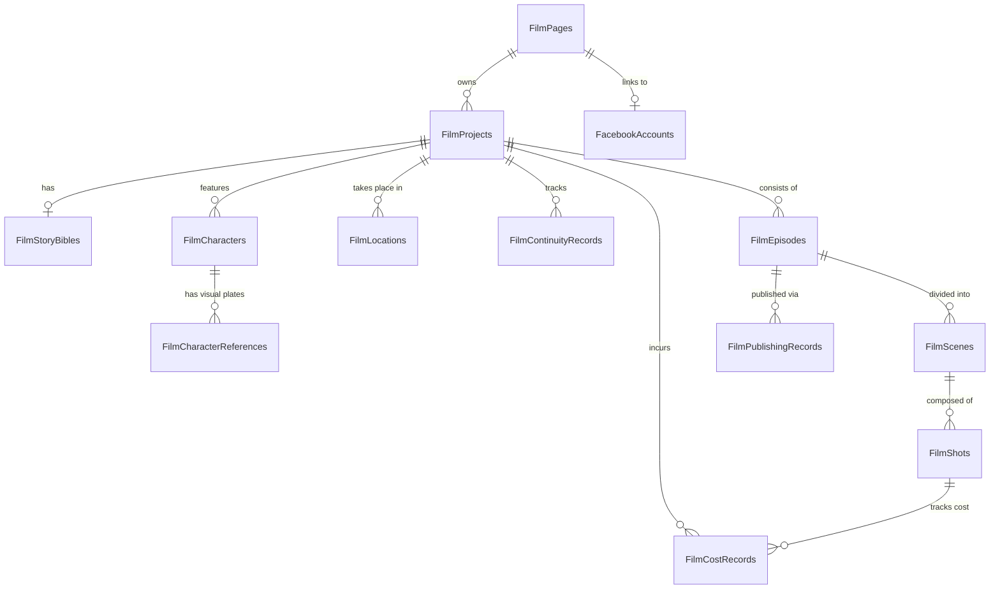

# BÁO CÁO THIẾT KẾ CƠ SỞ DỮ LIỆU AI FILM FACTORY
## Mô hình thực thể quan hệ, Schema PostgreSQL và Cơ chế quản trị dữ liệu phim

**Tài liệu:** `AI_FILM_FACTORY_DATABASE.md`  
**Hệ quản trị CSDL:** PostgreSQL 16+  
**ORM:** Entity Framework Core 8.0 (Npgsql.EntityFrameworkCore.PostgreSQL)  
**Migration tương ứng:** `20261117091104_AddAiFilmFactory`  
**Ngày phát hành:** 17/11/2026  

---

## 1. NGUYÊN TẮC THIẾT KẾ DATABASE

Phân hệ AI Film Factory được xây dựng với các nguyên tắc dữ liệu nghiêm ngặt:
1. **Cô lập hoàn toàn:** Các bảng mới đều có tiền tố `Film*` (`FilmPages`, `FilmProjects`, `FilmStoryBibles`, `FilmCharacters`, `FilmLocations`, `FilmEpisodes`, `FilmScenes`, `FilmShots`, `FilmCostRecords`, `FilmPublishingRecords`).
2. **Không làm thay đổi schema hiện tại:** Toàn bộ bảng tin tức (`VideoProjects`, `Articles`, `ArticleImages`, `VideoScenes`, `FacebookAccounts`, `FacebookPosts`, `SystemSettings`, `AiUsages`) được giữ nguyên 100%.
3. **Bộ nhớ dài hạn (Persistent Bible Memory):** Series Bible được lưu trữ dưới dạng cấu trúc bảng chi tiết thay vì một khối text đơn thuần, giúp Showrunner AI có thể truy vấn nhanh từng nhân vật, địa điểm và quy tắc thế giới ở bất kỳ thời điểm nào.
4. **Quản trị chi phí chi tiết đến từng shot:** Bảng `FilmCostRecords` lưu vết mọi giao dịch tài chính (tokens LLM, số lượng ảnh, số giây thoại, giá thành USD) liên kết trực tiếp với từng dự án và từng cú máy.

---

## 2. SƠ ĐỒ THỰC THỂ QUAN HỆ (ERD)



---

## 3. CHI TIẾT 11 BẢNG DỮ LIỆU CỐT LÕI

### 3.1. Bảng `FilmPages` (Quản lý 5 Kênh Phim Chuyên Biệt)
Lưu thông tin định vị thương hiệu, phong cách thẩm mỹ và cấu hình mặc định của từng Film Page:

| Tên Cột | Kiểu Dữ Liệu | Ràng buộc | Mô tả |
| :--- | :--- | :--- | :--- |
| `Id` | `uuid` | PK | Khoá chính |
| `PageNumber` | `integer` | NOT NULL, UNIQUE | Số thứ tự kênh (1 đến 5) |
| `Name` | `varchar(200)` | NOT NULL | Tên Film Page (VD: CinemaX, DramaVerse, Mythos) |
| `Description` | `varchar(1000)`| NOT NULL | Mô tả định vị kênh |
| `PrimaryGenre` | `varchar(100)` | NOT NULL | Thể loại chủ đạo (SciFi, Drama, Fantasy, Thriller, Romance) |
| `VisualArtStyle`| `varchar(200)` | NOT NULL | Phong cách hình ảnh điện ảnh |
| `BrandColorHex` | `varchar(20)`  | NOT NULL | Màu nhận diện thương hiệu (`#3B82F6`, `#E11D48`, ...) |
| `DefaultVoice` | `varchar(100)` | NOT NULL | Giọng đọc mặc định (`vi-VN-NamMinhNeural`, ...) |
| `Language` | `varchar(20)`  | NOT NULL | Ngôn ngữ phát hành (`vi-VN`) |
| `TargetAudience`| `varchar(500)` | NOT NULL | Đối tượng khán giả mục tiêu |
| `AspectRatio` | `varchar(20)`  | NOT NULL | Tỉ lệ khung hình (`9:16`, `16:9`) |
| `LinkedFacebookAccountId` | `uuid` | NULL, FK | Liên kết tài khoản Facebook Page |
| `TotalProjectsCount` | `integer` | DEFAULT 0 | Tổng số series phim |
| `TotalEpisodesCompleted` | `integer` | DEFAULT 0 | Tổng số tập phim đã xuất bản |
| `TotalCostSpentUsd` | `numeric(12,4)`| DEFAULT 0.0000 | Tổng chi phí API đã chi tiêu |
| `IsActive` | `boolean` | DEFAULT true | Trạng thái kích hoạt kênh |
| `CreatedAtUtc` | `timestamp with time zone` | NOT NULL | Thời điểm tạo |
| `UpdatedAtUtc` | `timestamp with time zone` | NULL | Thời điểm cập nhật |

### 3.2. Bảng `FilmProjects` (Dự Án Series Phim 10 Tập)
Quản trị vòng đời của toàn bộ series phim:

| Tên Cột | Kiểu Dữ Liệu | Ràng buộc | Mô tả |
| :--- | :--- | :--- | :--- |
| `Id` | `uuid` | PK | Khoá chính |
| `FilmPageId` | `uuid` | NOT NULL, FK | Thuộc Film Page nào |
| `Title` | `varchar(300)` | NOT NULL | Tiêu đề series phim |
| `Logline` | `text` | NOT NULL | Ý tưởng / tóm tắt một câu của phim |
| `Genre` | `varchar(100)` | NOT NULL | Thể loại phim cụ thể |
| `VisualArtStyle`| `varchar(200)` | NOT NULL | Phong cách thị giác người thật AI |
| `AspectRatio` | `varchar(20)` | DEFAULT '9:16' | Tỉ lệ khung hình |
| `Status` | `varchar(50)` | NOT NULL | Draft, Outlining, Scripting, InProduction, Completed |
| `TotalBudgetLimitUsd` | `numeric(10,4)` | DEFAULT 5.0000 | Giới hạn ngân sách tối đa ($5.00) |
| `TotalActualCostUsd` | `numeric(10,4)` | DEFAULT 0.0000 | Chi phí thực tế đã sử dụng |
| `TargetEpisodes` | `integer` | DEFAULT 10 | Số tập mục tiêu (10 tập) |
| `CompletedEpisodesCount`| `integer` | DEFAULT 0 | Số tập đã dựng hoàn tất |
| `TargetDurationPerEpisodeSeconds`| `integer` | DEFAULT 300 | Thời lượng mỗi tập (300s = 5 phút) |
| `VisualRatioAiVideo` | `double precision` | DEFAULT 0.15 | Tỉ lệ AI video (15%) |
| `VisualRatioMotionImage` | `double precision` | DEFAULT 0.70 | Tỉ lệ ảnh điện ảnh Ken Burns (70%) |
| `VisualRatioMotionGraphics`| `double precision` | DEFAULT 0.15 | Tỉ lệ cutaway / cận cảnh (15%) |

### 3.3. Bảng `FilmStoryBibles` (Bộ Nhớ Cốt Truyện Dài Hạn)
Lưu trữ linh hồn và quy luật của tác phẩm điện ảnh:

| Tên Cột | Kiểu Dữ Liệu | Mô tả |
| :--- | :--- | :--- |
| `Id` | `uuid` (PK) | Khoá chính |
| `FilmProjectId` | `uuid` (FK, UNIQUE) | Thuộc dự án nào |
| `Logline` | `text` | Câu logline điện ảnh hoàn chỉnh |
| `Genre` | `varchar(100)` | Thể loại chuẩn hoá |
| `WorldRules` | `text` | 3–5 quy tắc thế giới bất khả xâm phạm |
| `TimePeriod` | `varchar(200)` | Bối cảnh thời đại |
| `GeographicSetting` | `varchar(300)` | Bối cảnh địa lý / không gian diễn ra |
| `MainConflict` | `text` | Xung đột kịch tính cốt lõi |
| `KeyMysteriesAndTwists` | `text` | Các bí mật và cú lừa (plot twists) |
| `ClimaxResolution` | `text` | Đỉnh điểm và giải pháp kết thúc ở tập 10 |
| `OverallArcOutline` | `text` | Kết cấu 3 hồi xuyên suốt 10 tập |
| `EpisodesSummaryJson` | `text` | JSON dàn ý chi tiết 10 tập |

### 3.4. Bảng `FilmCharacters` & `FilmCharacterReferences` (Quản Lý Nhân Vật & Tính Nhất Quán)
Đảm bảo khuôn mặt nhân vật không bị biến dạng qua các tập:

- **`FilmCharacters`:**
  - `CharacterId` (VD: `CHAR_MINH`, `CHAR_AN`, `CHAR_LINH`, `CHAR_TRUC`).
  - `Name`, `Role`, `Age`, `Gender`, `PhysicalAppearance`, `Hairstyle`, `DefaultCostume`.
  - `Personality`, `EmotionalTrait`.
  - `VoiceModel` (Mô hình giọng đọc EdgeTTS gán riêng cho nhân vật).
  - `ConsistencyPrompt` (Đoạn prompt chuẩn mực neo giữ ngũ quan, góc cạnh gương mặt và làn da nhân vật qua mọi cú máy).
- **`FilmCharacterReferences`:**
  - Lưu ảnh tham chiếu đa góc nhìn: Chính diện (Front), Góc nghiêng 45 độ (Side), Toàn thân (FullBody), Biểu cảm (Emotion).

### 3.5. Bảng `FilmLocations` (Bối Cảnh Phim)
- `LocationId` (VD: `LOC_TIEM_DONG_HO`, `LOC_THAP_CHUONG`, `LOC_NGO_HEM_MUA`).
- `ArchitectureStyle`, `LightingMood`, `TimeOfDay`, `KeyProps`, `ReferenceImageUrl`.

### 3.6. Bảng `FilmEpisodes` (Quản Lý 10 Tập Phim)
- `EpisodeNumber` (1 đến 10).
- `Title`, `Synopsis`.
- `OpeningHook` (Cảnh móc đầu tập thu hút người xem).
- `EndingCliffhanger` (Nút thắt kịch tính cuối tập kích thích xem tiếp).
- `TargetDurationSeconds` (300 giây).
- `ActualDurationSeconds`.
- `Status` (`Pending`, `Scripting`, `AssetGenerating`, `FilmEditing`, `Completed`, `Failed`).
- `OutputVideoPath` (Đường dẫn file MP4 xuất bản).
- `ThumbnailPath` (Ảnh bìa tập phim).
- `EstimatedCostUsd`, `ActualCostUsd`, `QualityScore`.

### 3.7. Bảng `FilmScenes` & `FilmShots` (Phân Cảnh & Từng Cú Máy)
- **`FilmScenes`:** Chia mỗi tập thành 6 phân cảnh logic gắn với địa điểm cụ thể.
- **`FilmShots`:** Chia mỗi cảnh thành 6 cú máy chuẩn điện ảnh:
  - `ShotNumber` (1 đến 6).
  - `ShotType` (`ExtremeWide`, `Wide`, `Medium`, `CloseUp`, `ExtremeCloseUp`).
  - `CameraMovement` (`SlowZoomIn`, `SlowZoomOut`, `PanLeft`, `PanRight`, `TiltUp`, `TiltDown`, `Static`).
  - `VisualMethod` (`MotionImageKenBurns`, `AiVideo`, `MotionGraphics`).
  - `VisualPrompt`, `NegativePrompt`.
  - `SpeakerCharacterId`, `DialogueText`, `ActingInstructions`, `EmotionalTone`.
  - `DurationSeconds`.
  - `RenderStatus`, `RenderedShotVideoPath`, `RawImagePath`, `AudioVoicePath`.

### 3.8. Bảng `FilmCostRecords` (Sổ Cái Quản Trị Chi Phí)
- `FilmProjectId`, `FilmEpisodeId`, `FilmShotId`.
- `Provider` (`Gemini`, `EdgeTTS`, `LocalFFmpeg`, `CloudVisual`).
- `ServiceType` (`ScriptLLM`, `VoiceTTS`, `VisualGen`, `VideoRender`).
- `QuantityUnits` (Số tokens, số ảnh, số giây thoại).
- `CostUsd` (Chi phí thực tế tính đến 6 số thập phân).
- `IsFreeTier` (True nếu dùng gói miễn phí).

### 3.9. Bảng `FilmPublishingRecords` (Quản Lý Xuất Bản Mạng Xã Hội)
- `TargetPlatform` (`FacebookReels`, `InstagramReels`).
- `PostTitle`, `Caption`, `HashtagsJson`.
- `PlatformPostId`, `PlatformVideoId`, `PublishedAtUtc`.
- `ViewCount`, `LikeCount`, `ShareCount`.

---

## 4. CHI TIẾT CHỈ MỤC VÀ TỐI ƯU TRUY VẤN (INDEXES)

Để đảm bảo hiệu năng cao khi dựng 10 tập phim cùng lúc:
- `IX_FilmPages_PageNumber` (UNIQUE): Truy xuất nhanh 5 Film Page.
- `IX_FilmProjects_FilmPageId`: Lấy danh sách series theo kênh.
- `IX_FilmProjects_Status`: Lọc các dự án đang trong quá trình sản xuất.
- `IX_FilmEpisodes_FilmProjectId_EpisodeNumber` (UNIQUE): Đảm bảo thứ tự tập 1-10 không trùng lặp.
- `IX_FilmScenes_FilmEpisodeId_SceneNumber`: Sắp xếp các cảnh theo đúng mạch kịch bản.
- `IX_FilmShots_FilmSceneId_ShotNumber`: Lấy chính xác chuỗi shot phục vụ FFmpeg Concat.
- `IX_FilmCostRecords_FilmProjectId`: Tính tổng chi tiêu thời gian thực của series.

---

## 5. THỰC THI MIGRATION THÀNH CÔNG

Migration `20261117091104_AddAiFilmFactory` đã được tạo và apply trực tiếp vào PostgreSQL:
```bash
dotnet ef migrations add AddAiFilmFactory --project backend/src/NewsStudio.Infrastructure --startup-project backend/src/NewsStudio.Api
dotnet ef database update --project backend/src/NewsStudio.Infrastructure --startup-project backend/src/NewsStudio.Api
```
Kết quả kiểm tra trực tiếp: 11 bảng được tạo thành công, 0 lỗi cú pháp, 100% tương thích ngược với hệ thống tin tức.
