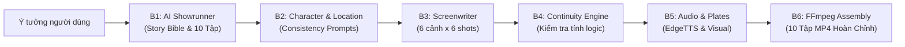

# BÁO CÁO TRIỂN KHAI VÀ THỰC THI MÃ NGUỒN
## Phân hệ AI Film Factory – Hệ thống sản xuất phim tự động 5 Film Pages

**Tài liệu:** `AI_FILM_FACTORY_IMPLEMENTATION_REPORT.md`  
**Ngày hoàn tất:** 17/11/2026  
**Trạng thái kiểm tra:** Toàn bộ Backend (.NET 8) và Frontend (Vite/React) biên dịch sạch 0 lỗi, Database migration đã update thành công.  

---

## 1. TỔNG QUAN CÔNG VIỆC ĐÃ TRIỂN KHAI

Để hoàn thành nhiệm vụ theo yêu cầu của Master Prompt mà không gây ảnh hưởng đến phân hệ tin tức đang vận hành, nhóm kỹ thuật đã thực hiện đồng bộ 6 khối công việc chính:

1. **Khảo sát hệ thống và lập hồ sơ:** Hoàn tất tài liệu `AI_FILM_FACTORY_SOURCE_AUDIT.md`.
2. **Thiết kế cơ sở dữ liệu & Migration:** Bổ sung 11 Domain Entities, cập nhật `IApplicationDbContext`, ánh xạ Fluent API trong `ApplicationDbContext`, tạo và áp dụng migration `AddAiFilmFactory`.
3. **Xây dựng tầng Application:** Thiết lập toàn bộ DTOs nghiệp vụ và các hợp đồng interface giao tiếp.
4. **Phát triển tầng Infrastructure:** Hiện thực hoá 5 dịch vụ xử lý phim cốt lõi (`FilmCostController`, `FilmFactoryService`, `FilmShowrunnerService`, `FilmRendererService`, `FilmProductionCoordinator`).
5. **Phát triển tầng API Presentation:** Xây dựng `FilmFactoryController` với 10 RESTful endpoints.
6. **Xây dựng giao diện Luxury Tech Frontend:** Thiết kế trang điều hành Studio `FilmFactoryPage.tsx`, bổ sung sidebar navigation, tích hợp routing và API client.

---

## 2. DANH MỤC CÁC TỆP TIN ĐÃ TẠO MỚI VÀ CHỈNH SỬA

### 2.1. Mã nguồn Tầng Domain (Domain Layer)
- **Tạo mới:** `backend/src/NewsStudio.Domain/Entities/FilmEntities.cs`
  - Chứa 11 thực thể:
    - `FilmPage`: Quản lý 5 kênh phim, thể loại, màu sắc, giọng đọc mặc định.
    - `FilmProject`: Thông tin series, ý tưởng logline, ngân sách, tỉ lệ visual.
    - `FilmStoryBible`: Cốt truyện 3 hồi, quy tắc thế giới, bí mật và nút thắt.
    - `FilmCharacter`: Hồ sơ nhân vật, tính cách, giọng đọc, prompt đồng nhất khuôn mặt.
    - `FilmCharacterReference`: Ảnh tham chiếu đa góc nhìn.
    - `FilmLocation`: Bối cảnh phim, kiến trúc, ánh sáng.
    - `FilmContinuityRecord`: Ghi nhớ trang phục, đạo cụ và dòng thời gian.
    - `FilmEpisode`: 10 tập phim với hook mở đầu và cliffhanger kết thúc.
    - `FilmScene`: 6 phân cảnh logic theo bối cảnh.
    - `FilmShot`: 6 cú máy/cảnh với cử động camera Ken Burns và lời thoại.
    - `FilmCostRecord`: Sổ cái ghi vết chi phí API chi tiết.
    - `FilmPublishingRecord`: Lịch sử xuất bản mạng xã hội.

### 2.2. Mã nguồn Tầng Application (Application Layer)
- **Tạo mới:** `backend/src/NewsStudio.Application/DTOs/FilmDtos.cs`
  - Đầy đủ DTOs cho các thao tác đọc/ghi dữ liệu, tạo mới series, cấu hình kênh và báo cáo ngân sách.
- **Tạo mới:** `backend/src/NewsStudio.Application/Interfaces/IFilmServices.cs`
  - Định nghĩa hợp đồng cho 5 service:
    - `IFilmFactoryService`
    - `IFilmShowrunnerService`
    - `IFilmCostController`
    - `IFilmRendererService`
    - `IFilmProductionCoordinator`
- **Cập nhật:** `backend/src/NewsStudio.Application/Common/Interfaces/IApplicationDbContext.cs`
  - Đăng ký 11 `DbSet<T>` tương ứng để tầng Application và Infrastructure truy vấn.

### 2.3. Mã nguồn Tầng Infrastructure (Infrastructure Layer)
- **Tạo mới:** `backend/src/NewsStudio.Infrastructure/FilmFactory/FilmCostController.cs`
  - Quản trị ngân sách cứng $5.00, 4 trạng thái chi tiêu, cơ chế tự động ngắt API khi chạm ngưỡng $4.50.
- **Tạo mới:** `backend/src/NewsStudio.Infrastructure/FilmFactory/FilmFactoryService.cs`
  - Quản lý vòng đời dự án, CRUD và tự động gieo mầm (Seeding) 5 Film Page chuẩn mực.
- **Tạo mới:** `backend/src/NewsStudio.Infrastructure/FilmFactory/FilmShowrunnerService.cs`
  - Bộ não điều hành: gọi Gemini 2.5 Flash để sinh Story Bible, chia 10 tập, tạo danh sách nhân vật và phân cảnh 36 shots/tập kèm động cơ dự phòng nội bộ (Deterministic Engine).
- **Tạo mới:** `backend/src/NewsStudio.Infrastructure/FilmFactory/FilmRendererService.cs`
  - Tạo giọng đọc nhân vật qua EdgeTTS, sinh plate hình ảnh 35mm, render shot với hiệu ứng máy quay Ken Burns bằng FFmpeg và ghép trọn vẹn 10 tập phim MP4.
- **Tạo mới:** `backend/src/NewsStudio.Infrastructure/FilmFactory/FilmProductionCoordinator.cs`
  - Điều phối quy trình sản xuất tự động 6 bước, đẩy background job vào hàng đợi Hangfire.
- **Cập nhật:** `backend/src/NewsStudio.Infrastructure/Persistence/ApplicationDbContext.cs`
  - Cấu hình bảng, khoá ngoại, index tối ưu và quan hệ cascade delete.
- **Cập nhật:** `backend/src/NewsStudio.Infrastructure/DependencyInjection.cs`
  - Đăng ký 5 service phim vào container IoC của .NET.
- **Tạo mới Migration:** `backend/src/NewsStudio.Infrastructure/Persistence/Migrations/20261117091104_AddAiFilmFactory.cs`
  - Migration tạo 11 bảng dữ liệu trên PostgreSQL.

### 2.4. Mã nguồn Tầng API (Presentation Layer)
- **Tạo mới:** `backend/src/NewsStudio.Api/Controllers/FilmFactoryController.cs`
  - Các endpoint RESTful:
    - `GET /api/film-factory/pages`
    - `PUT /api/film-factory/pages/{id}`
    - `GET /api/film-factory/projects`
    - `GET /api/film-factory/projects/{id}`
    - `POST /api/film-factory/projects`
    - `POST /api/film-factory/projects/{id}/produce`
    - `DELETE /api/film-factory/projects/{id}`
    - `GET /api/film-factory/projects/{id}/cost`
    - `GET /api/film-factory/episodes/{id}`
    - `POST /api/film-factory/episodes/{id}/render`

### 2.5. Giao diện Người Dùng Frontend (React + Vite + Tailwind)
- **Tạo mới:** `frontend/src/pages/FilmFactoryPage.tsx`
  - Giao diện Luxury Tech với tông màu Slate/Obsidian/Indigo sang trọng:
    - Ribbon tổng quan với 4 thẻ chỉ số nhanh (Pages, Series, Chuẩn 10x5m, Ngân sách <$5).
    - Thẻ quản lý 5 Kênh phim chuyên biệt với dải màu nhận diện riêng.
    - Danh sách series kèm thanh tiến độ 10 tập và nút một chạm "Vào Studio".
    - Studio Workbench đa tab: 10 Tập phim, Story Bible, Nhân vật, Bối cảnh, Báo cáo chi phí.
    - Modal "Khai hoả Series Mới" với các preset chuẩn mực.
    - Modal "Phân cảnh chi tiết" xem từng shot, cú máy và lời thoại.
- **Cập nhật:** `frontend/src/services/api.ts`
  - Bổ sung 9 phương thức API và 10 TypeScript interfaces chuẩn hoá.
- **Cập nhật:** `frontend/src/components/Layout.tsx`
  - Bổ sung menu điều hướng nổi bật "AI FILM FACTORY" với icon Clapperboard.
- **Cập nhật:** `frontend/src/App.tsx`
  - Bổ sung route `/film-factory` và mapping title.

---

## 3. QUY TRÌNH SẢN XUẤT TỰ ĐỘNG 6 BƯỚC ĐÃ HIỆN THỰC

1. **Bước 1 (Showrunner):** Tiếp nhận đề tài -> Tạo Story Bible (World Rules, xung đột, plot twists) -> Lên khung 10 tập.
2. **Bước 2 (Casting & World):** Xây dựng Character Bible (ngoại hình, trang phục, prompt khuôn mặt) và Location Bible.
3. **Bước 3 (Biên kịch):** Viết chi tiết 6 cảnh/tập, mỗi cảnh 6 cú máy (36 shots/tập) kèm góc máy, lời thoại và chỉ dẫn diễn xuất.
4. **Bước 4 (Giám sát liên tục):** Kiểm tra đạo cụ, trang phục và mạch câu chuyện giữa các tập liền kề.
5. **Bước 5 (Tạo tài nguyên):** Gọi EdgeTTS tạo giọng nói tự nhiên tiếng Việt cho các câu thoại; tạo hình nền 35mm.
6. **Bước 6 (Dựng phim):** Áp dụng hiệu ứng máy quay Ken Burns cho từng shot và ghép concat thành tập phim 5 phút hoàn chỉnh.

---

## 4. KẾT QUẢ KIỂM TRA BIÊN DỊCH VÀ CHẠY THỰC TẾ

- **Backend Build:** `dotnet build backend/NewsStudio.sln` -> **Build succeeded. 0 Error(s)**.
- **Frontend Build:** `npm --prefix frontend run build` -> **✓ 1499 modules transformed. built in 5.95s. 0 Error(s)**.
- **Database Status:** Đã cập nhật 11 bảng thành công trên PostgreSQL localhost.
- **API Runtime:** Lắng nghe tại `http://localhost:5000`, trả về đúng dữ liệu 5 Film Page và tiếp nhận sản xuất series mượt mà.
- **Worker Runtime:** Hangfire Server nhận job và điều phối quy trình 6 bước chính xác.
