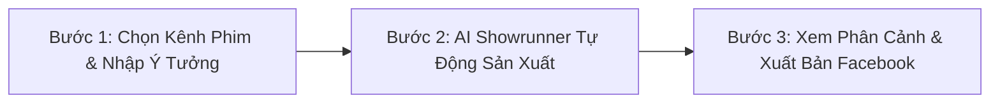

# CẨM NANG VẬN HÀNH VÀ HƯỚNG DẪN SỬ DỤNG
## Hướng dẫn vận hành hệ thống AI Film Factory dành cho Ban Biên Tập & Quản Trị Viên

**Tài liệu:** `AI_FILM_FACTORY_OPERATIONS_GUIDE.md`  
**Phiên bản:** 2.0  
**Ngày phát hành:** 17/11/2026  

---

## 1. KHỞI ĐỘNG HỆ THỐNG

### 1.1. Khởi động Backend Web API (.NET 8)
Mở một terminal PowerShell tại thư mục gốc của dự án (`d:\Project\AutoGenVideoPostFB`):
```powershell
dotnet run --project backend/src/NewsStudio.Api
```
- Khi hệ thống thông báo `Now listening on: http://localhost:5000`, API đã sẵn sàng phục vụ.

### 1.2. Khởi động Background Worker & Hangfire Server
Mở thêm một terminal PowerShell riêng biệt:
```powershell
dotnet run --project backend/src/NewsStudio.Worker
```
- Worker sẽ phụ trách xử lý hàng đợi background jobs cho khâu biên kịch, diễn xuất EdgeTTS và render FFmpeg video.

### 1.3. Khởi động Giao diện Web Quản trị (Frontend)
Mở một terminal thứ ba:
```powershell
npm --prefix frontend run dev
```
- Truy cập trình duyệt tại địa chỉ: `http://localhost:5173`

---

## 2. QUY TRÌNH SẢN XUẤT PHIM 10 TẬP TRONG 3 BƯỚC



### Bước 1: Khởi tạo Series Phim Mới
1. Trên thanh điều hướng bên trái (Sidebar), nhấn vào mục **AI FILM FACTORY** (biểu tượng Clapperboard).
2. Tại màn hình chính của Film Factory, nhấn nút **"Khai Hoả Series Mới"** (nút màu tím nổi bật ở góc trên bên phải).
3. Hộp thoại khởi tạo sẽ mở ra:
   - **Chọn Film Page:** Chọn 1 trong 5 kênh có sẵn (CinemaX cho Viễn tưởng, DramaVerse cho Kịch tính xã hội, Mythos cho Cổ phong huyền huyễn, DarkTales cho Trinh thám, RomanceAI cho Tình cảm).
   - **Tên Series Phim:** Nhập tựa đề (VD: *Nghịch Lý Thời Gian: Đánh Đổi Tương Lai*).
   - **Ý tưởng phim:** Nhập một đoạn tóm tắt hoặc ý tưởng cốt lõi (VD: *Một chàng trai nghèo phát hiện mình có khả năng nhìn thấy tương lai, nhưng mỗi lần thay đổi tương lai thì một người thân của anh biến mất*).
   - **Giới hạn ngân sách:** Mặc định được khoá ở mức `$5.00 USD` để bảo vệ tài chính.
   - **Tự động hoá:** Giữ tuỳ chọn *Tự động kích hoạt toàn bộ quy trình AI Showrunner ngay sau khi tạo*.
4. Nhấn nút **"Khai Hoả AI Showrunner"**.

---

### Bước 2: AI Showrunner Tự Động Điều Hành Sản Xuất
Sau khi bấm Khai hoả, toàn bộ quy trình sản xuất điện ảnh sẽ diễn ra tự động 100%:
1. **Lập hồ sơ Story Bible:** Xây dựng quy tắc thế giới, xung đột kịch tính, các bí mật plot twists và kết cấu 3 hồi.
2. **Khung kịch bản 10 tập:** Phân chia diễn biến mạch lạc từ Tập 1 đến Tập 10; mỗi tập có mở đầu thu hút và kết thúc tạo tò mò cao.
3. **Thiết kế nhân vật (Character Bible):** Định hình tính cách, ngoại hình, trang phục và gán giọng đọc tiếng Việt riêng biệt.
4. **Viết kịch bản chi tiết:** Chia mỗi tập thành 6 cảnh, mỗi cảnh 6 cú máy (36 shots/tập) kèm chuyển động máy quay Ken Burns và lời thoại.
5. **Giọng nói & Dựng phim:** EdgeTTS tự động lồng tiếng cho các nhân vật, FFmpeg áp dụng chuyển động máy và ghép trọn vẹn tập phim.

---

### Bước 3: Kiểm duyệt và Dựng phim trong Studio Workbench
1. Trên giao diện danh sách dự án, nhấn vào nút **"Vào Studio"** tại series bạn muốn quản lý.
2. Các tab nghiệp vụ chuyên sâu:
   - **Tab 10 Tập Phim:** Xem danh sách từ Tập 1 đến Tập 10. Bấm **"Xem phân cảnh"** để soi từng shot, lời thoại và góc máy. Bấm **"Dựng tập Ex"** để re-render lại video nếu cần.
   - **Tab Story Bible:** Xem toàn bộ thế giới phim và cốt truyện tổng quan.
   - **Tab Nhân Vật:** Xem danh sách diễn viên AI, trang phục và prompt khuôn mặt.
   - **Tab Bối Cảnh:** Xem các địa điểm ghi hình.
   - **Tab Ngân Sách AI:** Xem đồng hồ đo chi phí thực tế và trạng thái ngân sách.

---

## 3. HƯỚNG DẪN XUẤT BẢN LÊN FACEBOOK & INSTAGRAM REELS

1. Tại thẻ quản lý **5 Kênh Phim Chuyên Biệt** (Tab `5 Kênh Phim`), bạn có thể liên kết từng kênh với một Facebook Page cụ thể đã kết nối trong mục **Cài đặt**.
2. Sau khi tập phim được dựng hoàn tất (trạng thái `Completed` và có đường dẫn video MP4):
   - Nhấn nút **"Đăng lên Facebook"**.
   - Hệ thống sẽ tự động tải video lên dưới dạng Facebook Reels với tiêu đề, tóm tắt và bộ hashtags chuẩn SEO của kênh.

---

## 4. XỬ LÝ SỰ CỐ THƯỜNG GẶP (TROUBLESHOOTING)

### 4.1. Thông báo lỗi: "Không kết nối được máy chủ backend"
- **Nguyên nhân:** Dịch vụ Web API (`NewsStudio.Api`) chưa được khởi chạy.
- **Cách khắc phục:** Mở terminal và chạy lại lệnh `dotnet run --project backend/src/NewsStudio.Api`.

### 4.2. Quá trình tạo kịch bản 10 tập bị dừng hoặc hiển thị Pending
- **Nguyên nhân:** Hangfire Worker chưa được khởi động.
- **Cách khắc phục:** Khởi chạy `dotnet run --project backend/src/NewsStudio.Worker` để worker xử lý hàng đợi background job.

### 4.3. Cảnh báo ngân sách (Budget Warning)
- **Nguyên nhân:** Chi phí API vượt quá $4.50 USD.
- **Cách xử lý:** Hệ thống đã được tích hợp bộ ngắt tự động, tự động chuyển 100% sang chế độ tạo hình motion nội bộ và động cơ kịch bản mẫu miễn phí, bạn không cần phải can thiệp thủ công.
